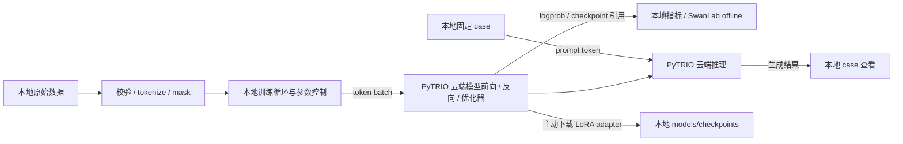

# sft-rl-flow

从经典强化学习到 LLM 后训练的**渐进式学习仓库**：每个阶段都有一个能跑通的最小实验，
讲清楚"为什么这么做"，而不只是"调用了哪个库"。

> 详细的工作规范、目录约定与硬件限制见 [`AGENTS.md`](AGENTS.md)。
> 学习路径见 [`docs/learning-roadmap.md`](docs/learning-roadmap.md)。

## 当前状态

- [x] uv + venv 环境、git 版本管理、GitHub 远端
- [x] 项目级 PyTRIO skill；本地数据/实验/日志/case，云端模型计算的 SFT 路径
- [ ] 配置 PyTRIO 账号与支持模型，验证一次真实云端训练和推理
- [ ] 阶段 1：表格型 RL（Q-Learning / SARSA）跑通 CartPole 之外的离散环境
- [ ] 阶段 2：策略梯度 → PPO（连续控制）
- [ ] 阶段 3：SFT（小模型 + LoRA）
- [ ] 阶段 4：偏好对齐（DPO / GRPO）

## 快速开始

```powershell
uv sync                      # 创建 .venv 并安装依赖
uv run pytest                # 环境自检
uv run python scripts/train.py --config configs/rl/ppo_cartpole.yaml --dry-run
```

需要 LLM 相关依赖（transformers / trl / peft）时：

```powershell
uv sync --extra llm
```

经典 RL 仍为骨架，只有 `--dry-run`，不执行本地训练。当前新增的可执行训练路径是云端 SFT。

## 本地编排 + 云端计算



无需将整个仓库或原始数据目录上传到 PyTRIO，SDK 会发送构造后的 token batch。
权重和训练状态保存在云端，本地保存引用；下载的是 PEFT LoRA adapter ZIP。
指标和 case 始终保存在本地；当前配置保留用户选择的 SwanLab `mode: cloud`，
需要认证才能上传。只在本地记录时，将 YAML 的 `logging.mode` 改为 `offline`；
`.env` / shell 的 `SWANLAB_MODE` 优先于 YAML。

先运行不需要账号、模型或网络的本地准备：

```powershell
uv run python scripts/prepare_data.py --config configs/sft/pytrio_toy.yaml --toy
uv run python scripts/train.py --config configs/sft/pytrio_toy.yaml --dry-run
```

`--dry-run` 只校验数据格式和配置并写快照，不下载 tokenizer、不校验模型特有 mask、
不执行云端调用，也不生成训练指标。数据文件相同则跳过，不同则拒绝覆盖。

账号准备好后，在本地登录并选择服务当前支持的模型：

```powershell
uv sync --extra cloud
uv run trio login
uv run python scripts/cloud.py models
uv run python scripts/train.py --config configs/sft/pytrio_toy.yaml --set "model.base_model=<查询返回的模型名>"
```

## 独立配置与调参

RL 和 SFT 各自使用完整 YAML，没有公共 base 或 `defaults` 继承：

| 配置 | 用途 |
|---|---|
| `configs/rl/ppo_cartpole.yaml` | PPO 的环境、折扣率、GAE、clip 等参数 |
| `configs/sft/pytrio_toy.yaml` | 未选模型时的数据准备与离线验证 |
| `configs/sft/qwen3.5-4b-lora-r8-lr1e-4-bs1.yaml` | 按模型、LoRA rank、学习率、batch 命名的独立示例 |

SFT 常调项：`model.base_model`、`model.lora_rank`、LoRA 训练层开关、`data.max_length`、
`train.lr`、`train.batch_size`、`train.epochs`、保存频率、`optimizer.weight_decay`、
`optimizer.grad_clip_norm`、Adam betas / eps 和 `sampling` 生成参数，全部实际接入执行代码。
当前 PyTRIO SDK 无 4bit、LoRA alpha/dropout 配置入口，因此示例不标注这些参数。
Qwen 配置是模型选择示例，正式训练前仍需查询当前服务支持列表。

复制一份配置做固定实验时，同步修改文件名和 `run_name`。临时覆盖示例（只做离线验证）：

```powershell
uv run python scripts/train.py --config configs/sft/qwen3.5-4b-lora-r8-lr1e-4-bs1.yaml --dry-run --set train.lr=2e-4 --set train.batch_size=2 --set optimizer.weight_decay=0.01 --set optimizer.grad_clip_norm=1.0 --set run_name=qwen3.5-4b-lora-r8-lr2e-4-bs2
```

外部数据下载脚本放在 `data/download_data/`，命名为 `download_<数据集名>_<数据量>.py`；
例如 `download_gsm8k_1000.py`（仅命名示例）。数据写入 `data/raw/`，规则见
[`docs/data-downloads.md`](docs/data-downloads.md)。

将 `<run目录>` 替换为训练入口实际打印的绝对目录；监控命令可在第二个终端运行：

```powershell
uv run python scripts/inspect_run.py --run <run目录> --kind metrics --watch
uv run python scripts/sample.py --run <run目录> --base
uv run python scripts/sample.py --run <run目录>
uv run python scripts/inspect_run.py --run <run目录> --kind cases
uv run python scripts/cloud.py checkpoints
uv run python scripts/cloud.py download --checkpoint-id <权重ID>
```

`Ctrl+C` 停止本地训练循环；已完成的云端更新和已保存的 checkpoint 保留，当前请求可能仍在云端完成。
本地程序结束后不会自动继续后续 batch。完整职责、数据格式和产物说明见
[`docs/local-cloud-architecture.md`](docs/local-cloud-architecture.md)。

项目 skill 位于 [`.agents/skills/pytrio-skill/SKILL.md`](.agents/skills/pytrio-skill/SKILL.md)，
固定上游 0.2.2，安装来源与项目规则见 [SOURCE.md](.agents/skills/pytrio-skill/SOURCE.md)。
Codex 下一轮可发现该项目级 skill，不涉及 `-g` 全局安装。

## 目录

| 路径 | 用途 | 进 git |
|---|---|---|
| `src/rlflow/` | 可复用算法与环境代码 | ✅ |
| `.agents/skills/` | 项目级 PyTRIO skill 与上游许可证 | ✅ |
| `configs/` | 实验配置（YAML） | ✅ |
| `scripts/` | 下载数据、跑实验等入口 | ✅ |
| `notebooks/` | 探索性分析 | ✅ |
| `docs/` | 笔记、路线图、实验记录 | ✅ |
| `data/` | 原始/处理后数据 | ❌ |
| `models/` | 权重与 checkpoint | ❌ |
| `outputs/` | 每次 run 的日志与产物 | ❌ |

## 环境

- Python 3.12（由 uv 管理）
- 现有 PyTorch + CUDA 12.8 学习依赖保留；云端 SFT/推理不在本机加载模型
- PyTRIO SDK 通过 `cloud` extra 安装并由 `uv.lock` 锁定
- 实验跟踪：SwanLab（当前 YAML 显式选择 cloud，可切换 offline）
